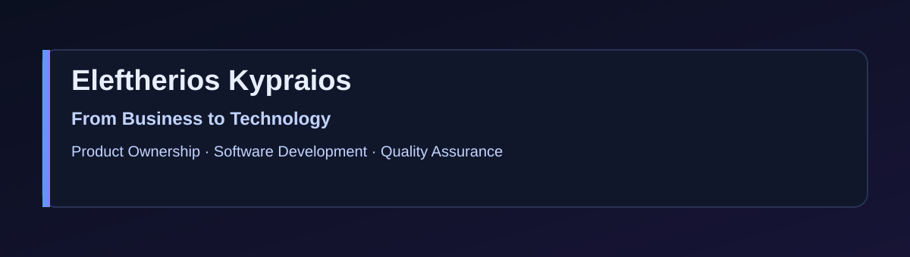

## Profile

I am Eleftherios Kypraios. My background brings together technical work as an industrial mechanic, infrastructure inspection, entrepreneurship, business development and customer-facing consulting. I am a certified Professional Scrum Product Owner I (PSPO I) and study software development at 42 Heilbronn.

I am building on that experience through hands-on software development and quality engineering. I research technical problems, clarify requirements, write code independently and with AI assistance, coordinate coding agents, investigate defects and verify implementations. I review agent-generated changes and make the technical decisions.

## Engineering and Quality

My work connects product needs, implementation and verification:

- **Product ownership:** clarify requirements and keep user and business needs in view.
- **Software development:** contribute directly to implementation, debugging and refinement.
- **AI-assisted engineering:** use coding agents as collaborators, coordinate their work and review generated changes.
- **Quality assurance:** investigate defects, assess risks and distinguish test coverage from verified results.

## Selected Case Studies

These case studies describe development contributions and later reviews of available project evidence.

- [Event Ownership Controls](case-studies/isynq-event-ownership-controls.md): authorization boundaries, ownership checks and the limits of recorded test evidence.
- [Guest Identity and Event Interactions](case-studies/isynq-guest-interaction-authorization.md): identity, event-specific access, persistence and outstanding realtime verification.
- [Summary Navigation and Regression Testing](case-studies/lf-digital-check-summary-navigation.md): a reported UI defect, source-supported findings and browser-testing limitations.
- [Public Intake Security and Validation](case-studies/lf-digital-public-intake-controls.md): server-side validation, access control, rate limiting and verification boundaries.

[Browse all case studies](case-studies/README.md)

## Assessments

The assessments are simulated practice exercises, not certifications or evaluations of real production systems.

| Assessment | Exercises | Focus |
|---|---:|---|
| [001: Introductory AI Evaluation](assessments/assessment-001-introductory-ai-evaluation/README.md) | 5 | Structured evaluation practice |
| [002: Mixed AI Quality Evaluation](assessments/assessment-002-mixed-ai-quality-evaluation/README.md) | 10 | Mixed quality dimensions |
| [003: AI Agent Quality Assurance](assessments/assessment-003-ai-agent-quality-assurance/README.md) | 10 | Agent-oriented scenario QA |
| [004: Advanced AI Quality Evaluation](assessments/assessment-004-advanced-ai-quality-evaluation/README.md) | 10 | Risk, evidence and governance |
| [005: Scenario-Based AI Agent Evaluation](assessments/assessment-005-real-world-ai-agent-evaluation/README.md) | 5 | Bilingual evaluations of simulated scenarios |

Assessments 001–004 are historical summaries. Their original prompts and individual responses are not available in this repository, so I have not reconstructed them. Assessment 005 presents five German evaluations with English translations; its scenario summaries are condensed, and the complete original prompts and reviewer transcripts are not included.

[Assessment index](assessments/README.md)

## Methodology and Resources

I document what was reviewed, what evidence supports a finding and what remains unverified. For project case studies, I distinguish development work from later evidence review. For assessments, I identify simulated scenarios and do not infer missing responses.

- [Evaluation Methodology](methodology/evaluation-methodology.md)
- [Assessment Workflow](assets/graphics/assessment-workflow.svg)
- [QA Assessment Report Template](templates/qa-assessment-report-template.md)
- [Severity Classification](assets/graphics/severity-scale.svg)

## Contact and Profiles

- [Website: elef.me](https://elef.me/)
- [GitHub: LF-hub42](https://github.com/LF-hub42)
- [LinkedIn: elefme](https://www.linkedin.com/in/elefme/)
- [Email](mailto:ekypraio@student.42heilbronn.de)
